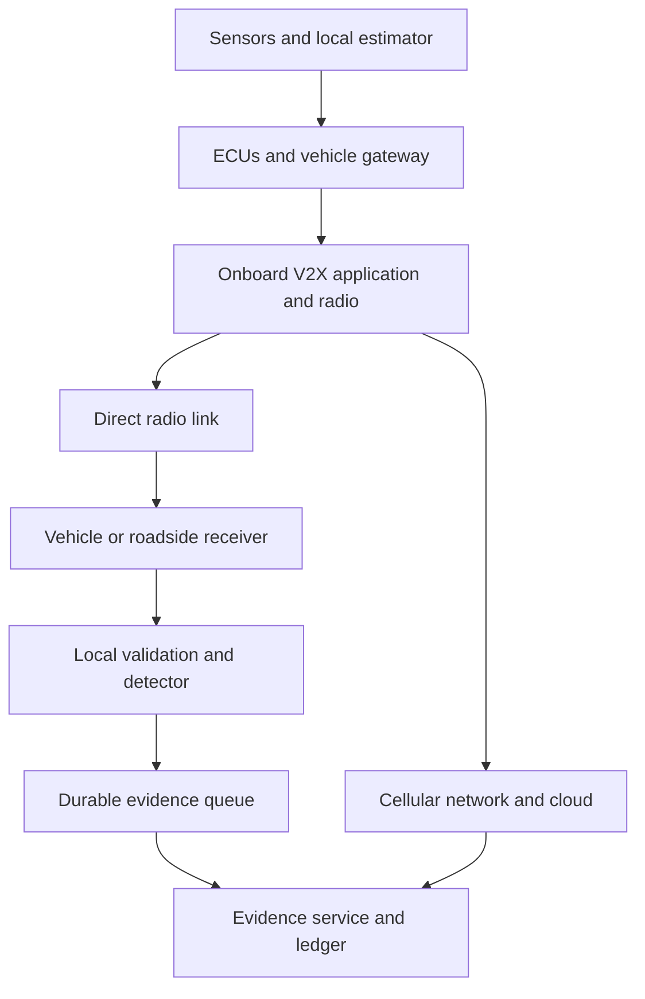

# 03 — Vehicle signal flow, devices and failure cases

## Start with one measurement

A speed/position observation may originate from wheel sensors, inertial sensors, GNSS or a fused estimator. An ECU or domain controller processes local measurements; a gateway exposes selected data to a communication unit. A V2X application constructs an outgoing message. A radio transmits it, and a receiving onboard unit or roadside unit decodes it and attaches its own receive metadata. Cloud upload is a separate path. Exact wiring and protocols depend on the vehicle platform; no single diagram describes every car.

This is a proposed RoadTrust observation architecture, informed by S01–S03; it is not a vehicle-specific wiring diagram.

| Layer | Devices/interfaces to investigate | What RoadTrust can observe | What it cannot infer automatically |
|---|---|---|---|
| Physical sensing | GNSS receiver, IMU, wheel encoders, camera/radar/LiDAR if available | Local readings and declared quality | Ground truth from a remote sender’s self-report |
| In-vehicle | ECUs, gateway, CAN/CAN FD controller/transceiver; Ethernet/LIN where platform uses them | Frames or authorized decoded signals | A vehicle-specific signal definition without a DBC/specification |
| Communication | OBU, antennas, V2X radio, secure key storage; RSU for infrastructure | Decoded message, local arrival metadata, available radio/auth checks | Physical identity merely from a changing pseudonym |
| Backhaul | Cellular modem/TCU, router, base station/core network | Service reachability, transport behavior | Continued cloud reachability from direct-radio health |
| Evidence | Edge storage, signing key, backend, validators | Captured observations and commit receipts | Whether the original measurement was true |

SocketCAN is a Linux interface for the CAN track [S01]. CAM is a defined message service, not the name of a radio [S03]. BSM/J2735 and IEEE 1609.2 belong on a separate profile-review list if a US-style stack is selected; their full specifications were not reviewed here. Avoid mixing their encoding with CAM silently.

## What “the internet is corrupted” can mean

A public-internet outage, cellular coverage loss, direct-radio interference, forged data and invalid credentials are different cases. Direct PC5 operation can be available without a working cloud connection, subject to radio capabilities and provisioning [S02]. It is not an automatic universal fallback. GNSS loss is also distinct from internet loss.

The proposed edge behavior below is a design to test, not a guarantee already implemented.

| Case | Expected impact | Required RoadTrust behavior | Validation evidence |
|---|---|---|---|
| WAN unavailable; direct radio healthy | Cloud UI and anchoring unavailable | Continue local checks/inference; persist queue; show pending evidence | Disconnect/reconnect trace with no lost acknowledged incident |
| Cellular coverage lost | Network-assisted services may fail | Report precise link state; do not assume direct mode is usable | Chosen radio/profile out-of-coverage experiment |
| Direct radio congestion/loss | Missing, delayed, uneven observations | Mark visibility degraded; track stale data and missingness | Network-simulator delivery trace and benign FPR |
| Suspected radio interference | Similar symptom to congestion or obstruction | Report degradation; do not label every dropout malicious | Matched benign/attack cases; distinguish uncertainty |
| GNSS loss or multipath | Position quality falls | Expose uncertainty; disable unsupported residuals or select a trained profile | GNSS-error sweeps and recovery trace |
| Sender clock manipulated | Claimed time unreliable | Use receiver monotonic time for local windows; bound claims | Timestamp/replay fixtures |
| Receiver time jumps/restarts | Window and expiry errors possible | Separate monotonic ordering from UTC; create a new boot epoch | Clock reset and restart tests |
| Invalid signature or unknown issuer | Authentication failure | Preserve bytes and reason; separate this from ML score | Known-valid/invalid test vectors |
| Valid signature, false telemetry | Authentication succeeds | Continue plausibility/detection checks | Credential-valid misbehavior scenario |
| Certificate expiry/revocation while offline | Trust information may be stale | Display revocation freshness; apply a documented conservative policy | Cached-policy expiry and reconnection test |
| Legitimate pseudonym rotation | Identity history changes | Reset bounded state; avoid a false Sybil claim | Repeated privacy rotations in normal traffic |
| Compromised RSU/receiver | Local observation or logs may lie | Record reporter identity; cross-check only where independent evidence exists | Conflicting multi-receiver observations |
| Backend/database down | Upload unavailable | Bound local backlog and apply declared disk policy | Queue saturation and service recovery |
| Blockchain quorum lost | New commitments cannot finalize | Continue detection; clearly retain pending status | Partition campaign; verify catch-up |
| Queue disk full | Evidence cannot all be retained | Explicit loss counter and priority/retention policy; never claim complete capture | Capacity limit and alarm test |
| Malformed or oversized frames | Parser/memory pressure | Bounded parser, schema rejection and rate limits | Malformed-input and resource tests |
| New benign road/density | Distribution shifts | Monitor drift and abstain when required | Held-out geography/density results |
| New attack family | Supervised labels incomplete | Mark unknown/out-of-distribution; avoid invented attack type | Leave-one-family-out evaluation |

## Receiver observation contract

Preserve raw input separately from normalized fields. Proposed envelope:

- Identity: `observation_id`, `receiver_id`, `boot_id`, `arrival_seq`, transport/profile version and observable sender alias.
- Time: raw source timestamp, its unit/clock domain, trusted local monotonic arrival time, optional UTC and uncertainty. Keep integer nanoseconds until conversion relative to an epoch to avoid precision loss.
- Payload: claimed motion/position plus coordinate reference, units, unavailable codes and provenance.
- Radio/authentication: optional measurements, verification result, certificate reference and freshness of revocation information.
- Quality: missing-field mask, parser status, clock confidence, sensor uncertainty, dropped-frame counters if known.
- Lineage: recording, source-file hash, adapter version and base scenario/drive identity; these are metadata, not default model features.

Keep annotations and simulator oracle data in a separate evaluation channel. The detector must not receive `attacker`, `true_label`, hidden physical sender identity or future observations. A receiver-specific state instance is keyed by receiver and session, never by the UI display buffer.

## Device selection evidence

Before choosing an OBU/RSU or CAN adapter, compare supported protocol/profile, driver/API, timestamp quality, receive metadata, key storage, field upgrade mechanism, environmental limits, isolation and cost. Use a vendor manual and a bench test for every claimed capability. No device model, radio license or purchase has been selected in this dossier.

Begin with virtual/replayed interfaces. Hardware experiments should use a bench setup or appropriately authorized test environment; public-road actuation is outside the first product boundary.
