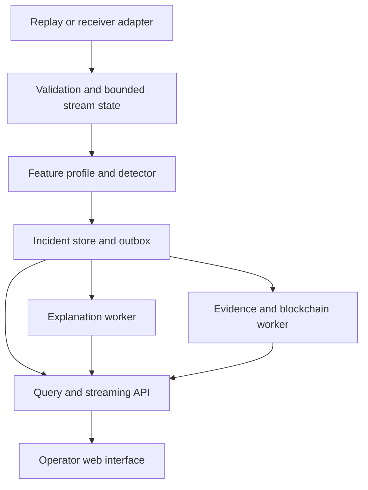

# 08 — Application architecture and GUI overhaul

## Proposed service boundary

The local detection path has bounded dependencies. Explanation and consensus are asynchronous. Incident IDs join every view. Simulation control is a separate privileged interface so browsing an alert cannot accidentally restart a run.

## Technology decision table

These are proposals with reasons and reversal conditions. None is described as selected by a benchmark that has not happened.

| Component | Proposed starting point | Why it fits this project | Alternative / evidence required |
|---|---|---|---|
| Core language | Python, initially compatible with existing code | Reuses extractor, models and tests | Change runtime only after profiling a target-device bottleneck |
| Contracts | Versioned typed models and JSON schemas | Make units, missing fields and API expectations reviewable | Pydantic is a candidate; validate throughput and schema migration |
| Data artifacts | Immutable raw files; normalized columnar files plus JSON manifests | Separate source evidence from derived training inputs | Small JSON/CSV samples are acceptable; profile larger runs before committing |
| API | FastAPI [S30] | Fits the Python core and supports explicit API schemas | Flask or another service is viable; contract and load evidence decide |
| Evidence database | Transactional relational database; Postgres candidate for staging | Incident/outbox consistency, concurrent access and queries | SQLite can serve an isolated local agent; measure contention and recovery |
| Large evidence | Encrypted object/file store with access control | Avoid large payloads in SQL or on-chain | Local durable volume for first stage; test backup and retention |
| Background work | Database-backed outbox first | Simple recoverable handoff with idempotency | Dedicated broker only when measured volume/reliability justifies it |
| Experiment catalog | Manifest files first; MLflow candidate [S31] | Connect metrics, parameters and artifacts | Avoid a tracking service that becomes required for local inference |
| GUI | React/TypeScript candidate | Independent client and reusable investigation components | Keep Streamlit during core migration; framework choice follows a working API |
| Live updates | Server-sent events or WebSocket based on interaction needs | Decouple presentation from processing | Polling may suffice initially; verify reconnect and dropped updates |
| Packaging | Reproducible containers and a small service composition | Consistent staging and recovery testing | No cluster orchestration unless scaling evidence warrants it |
| Monitoring | Structured logs, metrics and traces | Find stage failures and trace incident provenance | Choose implementation after defining signals and data-redaction rules |
| Ledger | Fabric/Besu experiments | Satisfies multi-node audit investigation | Final choice pending E09 |

For each introduced package: record exact version, license, maintenance status at selection time, supported target architecture, attack surface, reason, alternative and removal path. A familiar framework is not a substitute for testing its behavior under this workload.

## API and state contracts

Proposed endpoints: receiver health/capabilities; run creation/status; observation query/replay; incident query/details; explanation status; evidence verification; dataset/feature registry; and benchmark comparisons. Define pagination, filters, schema version, permission checks and error responses. Long-running jobs return IDs and status; a UI connection is not their owner.

Health should include adapter connectivity, receiver clock status, active model/schema/profile, recent message age, inference lag, resource pressure, explanation backlog, evidence backlog and last valid commitment. A reachable HTTP server does not prove the detector is functioning.

Identity roles: viewer, investigator, experiment operator and administrator. Enforce permissions on the server, not only by hiding buttons. Use controlled device identities and an appropriate login provider for staging. Review raw-data access and exports separately from summary access.

## The redesigned GUI

| Screen | Main task | Required information and state |
|---|---|---|
| Operations overview | Determine whether observations and processing are healthy | Receiver map/list, freshness, link/clock state, backlog; live versus replay label |
| Incident explorer | Find and prioritize suspicious events | Time/source filters, aggregated episodes, measured severity rationale, unknown classification |
| Incident detail | Understand what was observed and why it was flagged | Original observation, normalized units, history, score/threshold, model version and explanation status |
| Feature Inspector | See why an input exists and whether it is available | Formula, source field, trust, uncertainty, references, ablations, decision and known failures |
| Experiments | Compare eligible algorithms fairly | Same dataset/split/profile, uncertainty, latency/resources, failed runs and observed limitations |
| Simulation lab | Run reproducible scenarios | Adapter/config versions, seed, density, impairments; privileged run controls |
| Evidence verification | Check provenance and commitment | Captured/queued/submitted/committed states, digest, receipt, verifier result and raw-data permissions |
| System administration | Operate safely | Roles, devices, model promotion/rollback, retention, key rotation and audit history |

Keep score, calibrated probability, label and ground truth visually distinct. Ground truth appears only in labelled evaluation/replay mode. Show uncertain or missing data explicitly. Include disconnected, stale, empty, loading, rejected-input, model-incompatible and permission-denied states. Tables need readable units; alerts must not rely on color alone; controls need keyboard access.

## E13 usability tasks

Can a new operator locate one alert, identify the affected receiver, explain the top recorded factors, find the model/dataset version, distinguish pending from committed evidence, and report a limitation without help? Record task completion, mistakes and time on a small representative group before polishing the interface.

## Deployment evidence

Versioned migrations; authenticated API; server-side permissions; TLS configuration; upload size/parser limits; secret handling; signed/trusted model promotion; dependency inventory; retention policy; backups and restore drill; queue crash recovery; log redaction; resource limits; staged rollout and rollback. Record the actual environment and capacity instead of calling the app production-ready after a container starts.

Run load and fault tests against frozen workload targets. In a shadow pilot, monitor detection and data quality without affecting vehicle behavior. Publish the remaining operating limits and the owner of each unresolved issue.
