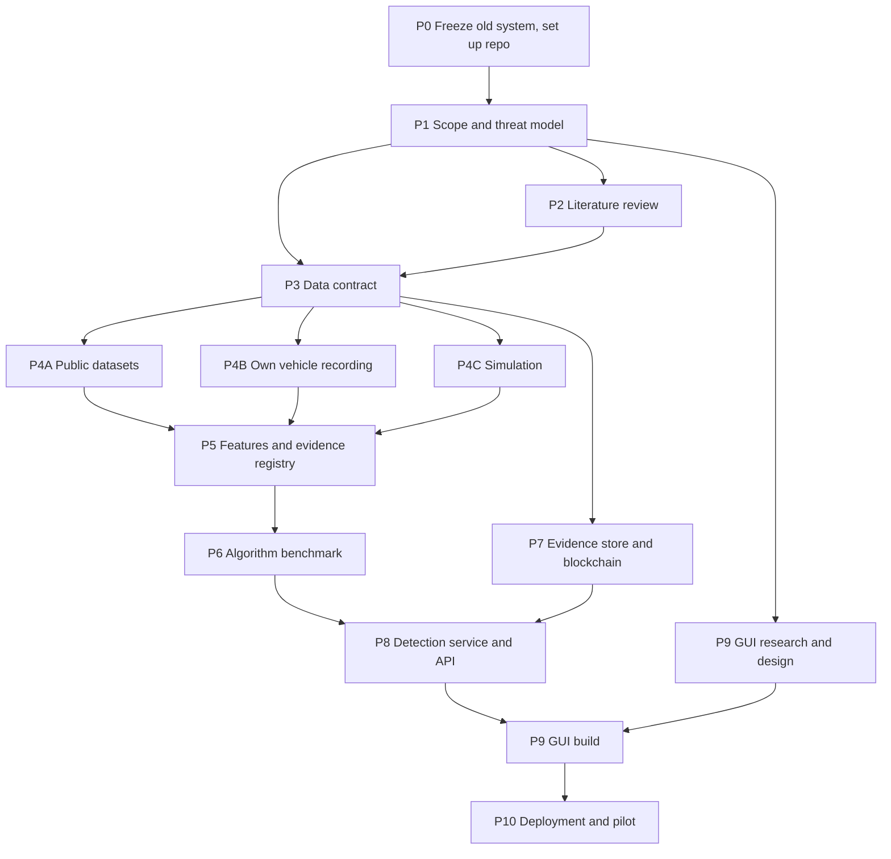

# 12 — Rebuild from scratch: step-by-step plan

**Status: proposed · 9 October 2026 · Owner: Mohamed Hamdoun**

This plan replaces the incremental milestone order in [09](09_delivery_plan.md) with a
greenfield rebuild. The research in chapters 00–08, 10 and 11 and all registries stay
valid as **input**. The hackathon code becomes a frozen reference, not a foundation.

## Why not fix the old baseline first?

Because most of it is going to be replaced. Correcting wording in code we will delete is
wasted effort. Two things from the old system still matter:

1. **Its measured score.** The old Random Forest becomes the reference row in the new
   benchmark. Every new model must beat it, or explain why not. That needs one clean
   reproduction run, not a refactor.
2. **Its lessons.** The audit findings (A01–A13 in [01](01_repository_audit.md)) become
   requirements for the new components. For example, A02 (missing val/test overlap check)
   becomes a built-in property of the new split and leakage auditor in step 4.6.

## What the rebuild keeps and drops

| Keep | Drop |
|---|---|
| Research dossier, registries, templates, requirements R01–R12 | Single-receiver toy simulator as the main data source |
| Old system, frozen in the `Cyberthorn-project` repo at tag `v0.3.0-hackathon`, as a reference | Streamlit app that drives the pipeline directly |
| Issue register and audit findings, as lessons learned | Local JSON hash chain as the evidence store |
| The receiver → feature → detect → explain → evidence idea | The 17-feature schema tied to a 2-D toy world |

## Rules that apply to every step

1. **Contracts before code.** Define the data format, units and clock rules before writing
   any adapter, feature or model.
2. **One observation format for every source.** Public datasets, your own recordings and
   simulators all produce the same receiver-observation records. A simulator is a data
   source, not a demo.
3. **One change = one commit = one record.** Every technology choice gets a decision record
   (ADR) and every code change gets a change record (CR). Each record covers the reason,
   exact change, pros, cons, alternatives considered, how to retest and how to revert. See
   [changes](changes/README.md).
4. **Labels never reach the detector.** Ground truth and simulator-only data travel in a
   separate channel used only for evaluation.
5. **Detection never waits.** The network, blockchain, explanation worker and GUI can all
   fail without stopping local detection.
6. **No winner before the test.** Nothing is called "optimal" until the frozen benchmark
   has run. The final choice is yours, made from the evidence.

## Phase map

| Phase | Question it answers | Main output | Relative size |
|---|---|---|---|
| P0 | What exactly are we replacing? | Tagged reference, reproduction record, new repo skeleton | S |
| P1 | Who uses it, against which attacker, on which radio profile? | Scope, threat catalog, measurable budgets | S |
| P2 | What does the evidence say about every layer? | 11 review chapters with decision implications | L |
| P3 | What does one observation look like? | Schema v1, units/clock rules, contract tests | M |
| P4 | Where does real and simulated data come from? | Data cards, adapters, simulation traces, split manifests | L |
| P5 | Which features are observable, and why keep each one? | Feature library, feature evidence registry, ablations | M |
| P6 | Which detector meets the budgets? | Benchmark harness, per-model limitation reports, your choice | L |
| P7 | What does a real blockchain add over a signed log? | Outbox, signed evidence, 2 chain spikes, failure campaign | L |
| P8 | Can it run as a service? | Headless pipeline, FastAPI, workers, monitoring | M |
| P9 | Can an operator investigate an alert unaided? | Design system, 8 screens, usability results | L |
| P10 | Can someone else install, run and recover it? | Staging stack, runbooks, shadow pilot report | M |

P4A/P4B/P4C run in parallel. P7 starts as soon as P3 fixes the incident format, so it runs
alongside P5–P6. GUI research and design (9.1–9.3) can start right after P1.

---

## P0 — Freeze the old system and set up the new repository

| Step | Do | Output |
|---|---|---|
| 0.1 | Tag `Cyberthorn-project` `main` as `v0.3.0-hackathon`. Leave its code untouched. **Done:** tag on `b4c4a03`, pushed to the `Cyberthorn-project` GitHub repo. | Git tag |
| 0.2 | Regenerate data and retrain once from the locked environment. Compare against archived `evaluation.json`. Record the predict_proba-vs-vote finding (56 of 32,297 test decisions flip at threshold 0.35). **Done:** exact match, see [E01](reproduction/E01_v0.3.0_reproduction.md). | Reproduction record (experiment E01) |
| 0.3 | Repository and layout. **Decided:** new private repo `roadtrust` ([ADR08](decisions/ADR08-separate-repository.md)); one repo with `core/` (Python package `roadtrust`), `sim/`, `chain/`, `web/`, `deploy/`, each created when its phase starts ([ADR09](decisions/ADR09-monorepo-layout.md)); one branch and PR per step ([ADR10](decisions/ADR10-branching-and-prs.md)). | ADR08, ADR09, ADR10 |
| 0.4 | Tooling: uv, ruff, pytest + hypothesis, pre-commit, GitHub Actions CI running tests and `tools/research/validate_registry.py`. **Decided:** Python 3.12 ([ADR11](decisions/ADR11-python-and-packaging.md)), Ruff + strict mypy + pre-commit + Hypothesis ([ADR12](decisions/ADR12-code-quality-tools.md)), GitHub Actions ([ADR13](decisions/ADR13-continuous-integration.md)). | CI green on empty skeleton |
| 0.5 | Change-record and ADR templates and an index; every later commit links one. **Decided:** ADR format from ADR08–13, enforced by the validator, a commit-message check and a PR template ([ADR14](decisions/ADR14-record-system.md)). | `docs/research/changes/` |
| 0.6 | Storage and compute. **Decided:** internal disk (100 GB free on 9 October) with a 60 GB project-data cap, data in `~/roadtrust-data` outside the repo, CARLA on the university lab GPU ([ADR15](decisions/ADR15-storage-and-compute.md)). | ADR15 |

## P1 — Scope and threat model

| Step | Do | Output |
|---|---|---|
| 1.1 | Confirm first deployment target. **Decided:** two profiles on one core, RSU and on-vehicle (OBU, with optional ego-sensor input and a lab-only driver warning); road-authority operators and researchers in one role-based app; replay, then lab bench; monitor and alert only ([ADR16](decisions/ADR16-deployment-targets-and-users.md)). | ADR16 (supersedes ADR01) |
| 1.2 | Choose V2X profile by target region: EU-style C-ITS (ETSI CAM/DENM, TS 103 097 security) or US-style (SAE J2735 BSM, IEEE 1609.2). Radio: ITS-G5/802.11p vs LTE-V2X PC5 vs NR-V2X. **Decided:** ETSI CAM first (BSM adapter later), 802.11p/ITS-G5 first (cellular via a later spike), authentication checked separately from ML ([ADR17](decisions/ADR17-message-radio-and-authentication.md)). | ADR17 |
| 1.3 | Threat catalog: attacker types (outsider without credentials, insider with valid credentials, compromised RSU, compromised sensor) × attacks (position/speed falsification, replay, DoS/flooding, Sybil, eventual stop, data replay, GNSS spoofing). Map each to the dataset that contains it. | `registries/threats.json` |
| 1.4 | Set measurable budgets: minimum event recall, maximum false incidents per receiver-hour, p99 latency, memory and CPU on target hardware, set per profile (RSU, OBU) plus a separate, stricter false-alarm budget for driver warnings. **These numbers are yours to choose.** | Updated requirements R04/R11 |
| 1.5 | Verify one end-to-end signal path (sensor → ECU → gateway → OBU → radio → RSU → detector). Mark each field as measured by receiver, claimed by sender, or simulator-only. | Signal and trust map |

## P2 — Literature review

Use the protocol in [02](02_literature_review.md): logged queries, primary sources first,
reading depth stated, one `literature_note.md` per source, and a decision implication at the
end of every chapter. Keep a reference manager (for example Zotero) with exported BibTeX in
the repo.

| Topic | Covers | Decisions it feeds |
|---|---|---|
| T1 In-vehicle networks | CAN, CAN FD, CAN XL, LIN, FlexRay, automotive Ethernet/SOME/IP, gateways, SecOC, DBC decoding, ISO/SAE 21434 and UN R155 context | CAN track scope, recording hardware |
| T2 Sensing and localization | GNSS errors, multipath, spoofing, RTK, IMU, wheel odometry, sensor fusion | Position uncertainty features, GNSS failure cases |
| T3 V2X communication | 802.11p/ITS-G5, LTE-V2X PC5, NR-V2X sidelink, Uu vs PC5, CAM/DENM/CPM/BSM rates, congestion control (DCC) | Message profile, simulator choice |
| T4 V2X security | PKI (EU CCMS, US SCMS), certificates, pseudonym change, revocation, misbehavior reporting (check ETSI's misbehavior-reporting specification and its status) | Authentication checks, evidence format |
| T5 Degraded operation | Out of coverage, backhaul loss, jamming, congestion, GNSS loss, clock sync (GNSS time, PTP), receiver restarts | Failure-case registry, offline design |
| T6 Misbehavior detection | Plausibility and consistency checks, VeReMi-based ML results, F2MD framework, Sybil detection under pseudonym change | Candidate features and models |
| T7 ML evaluation for security | Leakage, grouped splits, base rates, drift, event-level metrics | Benchmark protocol |
| T8 Explainable detection | SHAP and alternatives, fidelity, stability, operator studies | Explanation method, UI |
| T9 Evidence and ledgers | Signed logs, transparency logs, permissioned blockchains, consensus fault models, privacy | Blockchain choice |
| T10 Simulation fidelity | SUMO, Veins, Artery, F2MD, Eclipse MOSAIC, ns-3/5G-LENA, CARLA | Simulator choice |
| T11 Deployment hardware | RSU/OBU devices, edge computers, CAN adapters, timestamp accuracy, secure key storage | Hardware ADR |

Gate: each later ADR cites at least one reviewed chapter. A chapter is done when it ends
with decision implications and open experiments, not a list of paper summaries.

## P3 — Data contract

| Step | Do | Output |
|---|---|---|
| 3.1 | Receiver-observation schema v1 (Pydantic models + exported JSON Schema), using the envelope from [03](03_vehicle_and_failures.md): identity, time, payload, radio/auth, quality, lineage, plus receiver type (`rsu`/`obu`) and an optional ego-sensor channel (ADR16), and the seven-value authentication result with revocation freshness (ADR17). | `core/roadtrust/schema/` |
| 3.2 | Units, coordinates and clocks: SI units, true-north heading, integer-nanosecond receiver monotonic time, separate UTC with uncertainty, explicit "unavailable" values. | Conventions doc + ADR |
| 3.3 | Separate oracle channel for labels, attacker IDs and simulator truth. | Schema + tests that block it from features |
| 3.4 | Storage: raw files kept immutable; normalized Parquet; JSON manifest with hashes per dataset version. | ADR: storage format (alternatives: CSV, a database) |
| 3.5 | Contract fixtures: heading wrap, unit conversion, missing fields, equal and out-of-order timestamps, pseudonym change. | Test suite every adapter must pass |
| 3.6 | Incident and evidence record v1: what P7 commits and P8 serves. | Schema + ADR |

## P4 — Data sources (three parallel streams)

Every source gets a data card ([template](templates/data_card.md)) before full download:
license, version, checksums, size, fields, labels, clocks, identity semantics, lineage.

### P4A — Public datasets

| Step | Dataset | Role |
|---|---|---|
| 4A.1 | VeReMi Extension (D02) and VeReMi NextGen (D03) | Labelled V2X misbehavior, simulated; audit a sample of each, then pick the primary benchmark |
| 4A.2 | nuScenes CAN expansion (D04); evaluate comma2k19 and similar real driving logs as candidates | Real benign driving dynamics: how honest vehicles really move |
| 4A.3 | BerlinV2X (D05) | Real radio and GPS conditions: what benign impairment looks like |
| 4A.4 | ROAD (D06); evaluate other CAN intrusion sets as candidates | Real CAN with attacks, for the separate CAN track |
| 4A.5 | One adapter per dataset → schema v1, passing the P3 fixtures | `core/roadtrust/adapters/` |

### P4B — Your own vehicle recording (optional, real data)

| Step | Do |
|---|---|
| 4B.1 | This recording is also the main source of OBU ego-sensor data (ADR16). Choose passive hardware: an OBD-II/CAN logger (for example CANable, PEAK, Kvaser, comma panda) plus phone or external GNSS. ADR with cost, timestamp quality and driver support. |
| 4B.2 | **Read-only recording only.** No frame injection on a real vehicle. Attacks happen only on virtual CAN (`vcan`) or a bench. |
| 4B.3 | Record benign drives with a written protocol (route, time, weather, vehicle). Decode with a DBC file only where you have the right to use it. |
| 4B.4 | Adapter → schema v1, data card, privacy review (location traces are personal data). |

### P4C — Simulation as a data source

| Step | Do |
|---|---|
| 4C.1 | Compatibility spike in Docker: SUMO + Veins (OMNeT++), Artery (ETSI ITS-G5 stack on Veins), F2MD (misbehavior framework on Veins), Eclipse MOSAIC. Measure install effort, protocol fit, determinism, trace quality on this Mac. |
| 4C.2 | Pick one (ADR06). Build a minimal scenario that emits per-receiver delivery events in schema v1, with ground truth in the oracle channel. |
| 4C.3 | Validation tests from E10: stopped car, constant speed, turn, hard brake; packet loss; determinism across reruns. |
| 4C.4 | Scenario library: densities, road types, pseudonym change, GNSS error, congestion, each attack from the P1 catalog, run closed-loop so DoS affects the radio. |
| 4C.5 | CARLA only for the later perception track, on the university lab GPU machine (ADR15). Not on this Mac. |

### 4.6 — Dataset assembly

Grouping manifests per source (scenario, drive, base trajectory, receiver). A split builder
that checks **every** pair of splits plus lineage and duplicate hashes (this is where A02's
lesson lives). Leakage audit report. No mixing rows from different datasets.

## P5 — Features and the feature evidence registry

| Step | Do | Output |
|---|---|---|
| 5.1 | Candidate catalog from T6 literature plus the 17 old features. For each: what it detects, which benign situation looks the same. | Feature cards (draft) |
| 5.2 | Availability matrix: feature × dataset/source. Which fields each website or dataset actually provides, and with what trust (measured, claimed, simulator-only). | `registries/feature_availability.json` |
| 5.3 | Implement each feature as a small pure unit with its own card (formula, units, dependencies, missing-value behavior, state size, cost), unit tests, property-based tests and a causal prefix-invariance test. | `core/roadtrust/features/` |
| 5.4 | Feature profiles per source (for example V2X with RSSI, V2X without RSSI, CAN). Missing inputs are masked and the model is retrained, never filled with fake constants. | Profile registry |
| 5.5 | Selection experiments: group ablations, leave-one-out, grouped permutation importance, stability across seeds and datasets. | Experiment E02 report |
| 5.6 | Decision per feature (keep, revise, remove) written into its card with measured benefit and known failures. These cards feed the GUI Feature Inspector. | Updated registry |

## P6 — Algorithm benchmark

| Step | Do |
|---|---|
| 6.1 | Freeze the protocol from [05](05_experiments.md) before any tuning: splits, budgets from 1.4, metrics (event recall, false incidents/hour, p99 latency, memory), tuning budget per model, seeds. Every result is reported per deployment profile (RSU, OBU). |
| 6.2 | One benchmark harness: config per model, same inputs, a saved result bundle (code commit, data hashes, predictions, timings). Experiment tracking ADR (MLflow vs plain manifests). |
| 6.3 | Wave 1: constant baseline, explicit rules, logistic regression, small tree, Random Forest, gradient boosting (XGBoost or LightGBM), plus the frozen v0.3.0 model as a reference row. |
| 6.4 | Wave 2, only for gaps wave 1 exposes: Isolation Forest, One-Class SVM, Kalman-filter innovation checks, autoencoder, GRU/temporal CNN. |
| 6.5 | Wave 3, only with a concrete hypothesis: graph models over receiver-visible relations. |
| 6.6 | One limitation report per model ([template](templates/experiment_report.md)): where it failed, false-alarm causes, missed events, cost, explanation quality. Rejected models are kept, not deleted. |
| 6.7 | Selection: drop models that fail a budget, compare the rest on a Pareto front, prefer the simpler one when differences are within uncertainty. **You make the final call** (ADR03). |
| 6.8 | Explanation method for the chosen model, tested for fidelity and stability (E08). |

## P7 — Evidence store and a real blockchain

| Step | Do |
|---|---|
| 7.1 | Governance first: name who would run nodes (for example road authority, fleet operator, insurer, university lab), who submits, who validates, who changes rules. |
| 7.2 | Transactional incident store + outbox: SQLite on the edge, Postgres centrally. Crash, retry and duplicate tests. |
| 7.3 | Canonical evidence encoding, Ed25519 signing, Merkle batching, per-incident inclusion proofs. Personal data stays off-chain. |
| 7.4 | Comparator baseline: signed append-only log with an external witness. |
| 7.5 | Spike A: Hyperledger Besu, QBFT, 4 validators in Docker, Solidity evidence-registry contract tested with Foundry. |
| 7.6 | Spike B: Hyperledger Fabric 3 (Raft and BFT ordering) with Go chaincode. |
| 7.7 | Failure campaign E09 on all three: validator loss, quorum loss, partition, crash before/after acknowledgment, key rotation, history rewrite. Pick ADR05 from the measurements. |
| 7.8 | Independent verifier CLI: given an incident and its evidence, prove it was committed and unchanged. |

## P8 — Detection service and API

| Step | Do |
|---|---|
| 8.1 | Headless pipeline: adapter → validation → per-receiver feature state → detector → incident store. Bounded queues and backpressure. |
| 8.2 | FastAPI service with the endpoints listed in [08](08_application_and_gui.md); OpenAPI spec; roles (viewer, investigator, experiment operator, admin) enforced server-side; live updates by server-sent events. |
| 8.3 | Background workers for explanations and chain submission; the evidence states `captured → queued → submitted → committed / failed`. |
| 8.4 | Observability: structured logs, Prometheus metrics, OpenTelemetry traces, health that reports detector lag and backlogs, not just "server up". |
| 8.5 | Load, crash-recovery and access-control tests (E11). |

## P9 — GUI overhaul

| Step | Do |
|---|---|
| 9.1 | Operator research: write the E13 tasks, sketch wireframes for the 8 screens in [08](08_application_and_gui.md). Can start right after P1. |
| 9.2 | Design system: color and type tokens, components, light/dark, accessibility (keyboard, contrast, not color-only alerts). |
| 9.3 | Stack ADR. Proposed React + TypeScript + Vite, MapLibre for maps, a client generated from the OpenAPI spec. Alternatives: Svelte, Next.js, keeping Streamlit for research only. |
| 9.4 | Build order: Operations overview → Incident explorer and detail → Feature Inspector → Evidence verification → Experiments → Simulation lab → Administration, plus the OBU driver-warning prototype (lab/simulator only, ADR16). |
| 9.5 | Playwright end-to-end tests including offline, stale and permission-denied states; usability test with real users. |

## P10 — Deployment and pilot

| Step | Do |
|---|---|
| 10.1 | Docker Compose staging stack: service, workers, Postgres, chain nodes, web, monitoring. TLS, secrets, backups and a rehearsed restore. |
| 10.2 | CI/CD with signed model promotion and rollback. |
| 10.3 | Shadow pilot: replayed or lab RSU traffic, monitored for a fixed period with no effect on any vehicle. |
| 10.4 | Operations report and limitations register: what was proven, under which conditions, and what was not. Decide whether to archive the old `Cyberthorn-project` repo. |

---

## Decisions needed from you before P1 can close

1. ~~First deployment target~~ — decided in [ADR16](decisions/ADR16-deployment-targets-and-users.md).
2. ~~Message and radio profile~~ — decided in [ADR17](decisions/ADR17-message-radio-and-authentication.md).
3. Team size, weekly hours and any deadline (competition round, graduation, paper).
4. ~~Storage and compute~~ — decided in [ADR15](decisions/ADR15-storage-and-compute.md).
5. Whether to record your own vehicle data (P4B) and with which car.
6. Who the blockchain participants would be in a real deployment.
7. The P1.4 budgets: acceptable false incidents per hour, minimum event recall, latency limit.

None of these blocks P0 or the start of P2.
