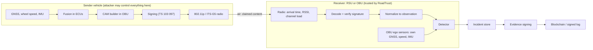

# 13 — Signal paths and trust map

**9 October 2026 · Plan step 1.5 · Decision: [ADR20](decisions/ADR20-signal-trust-map.md)**

Every value RoadTrust can see is labelled by **who controls it**. The machine-readable map
is [registries/signal_fields.json](registries/signal_fields.json) (86 fields); the
validator refuses any simulator-only or output field marked as a usable input.

## The four paths

| Path | Who controls the values | Can be a detector input? |
|---|---|---|
| Sender CAM (47 fields) | The sender. A credentialed insider can forge any of them consistently | Yes, as **claims** to be checked, never as facts |
| Receiver (14 fields) | The receiver: arrival time, radio measurements, decode and signature results, values it computes | Yes; the most trustworthy inputs |
| OBU ego (6 fields) | The receiving car's own sensors | Yes (OBU profile), but GNSS can be spoofed (TH17) |
| Evidence (6 fields) | RoadTrust's own outputs | Never: would create a feedback loop |

## Trust labels

| Label | Meaning | Allowed use |
|---|---|---|
| `claimed` | Written by the sender; forgeable | Input to plausibility/consistency checks |
| `measured` | Observed by the receiver's own radio or clock | Input |
| `measured_local` | Receiver's own vehicle or site sensors | Input (OBU/RSU profile) |
| `derived` | Computed by the receiver from other fields | Input; inherits the weakest source |
| `verified` | Result of a cryptographic check | Input beside the ML score (ADR17) |
| `oracle` | Exists only in a simulator or dataset (labels, true IDs, injected errors) | **Never** |
| `metadata` | Lineage or bookkeeping | Never as a value; some are grouping keys |
| `output` | Produced by RoadTrust | **Never** |

## What the field-level review found

1. **Real CAMs carry only a 65.536-second timestamp.** `generationDeltaTime` is the ETSI
   timestamp modulo 65,536 ms. VeReMi NextGen logs a full nanosecond `sendTime`. Any
   timing feature must be computed from the reduced value a real receiver would see, or
   the model learns a shortcut that does not exist on the road.
2. **VeReMi NextGen `*_noise` fields are simulator truth.** The field table calls them
   "uncertainty/confidence", but the generator documentation describes them as the
   injected GPS/speed/heading error. A real CAM carries a *claimed confidence*
   (`positionConfidenceEllipse`, `speedConfidence`), never the true error. Marked
   `oracle`; to be confirmed on a data sample (step 4A.1).
3. **`sender_id` and `messageID` have no real-world equivalent.** A receiver sees only the
   pseudonym (`stationID` / `sender_alias`). Both are forbidden as inputs.
4. **VeReMi NextGen includes receiver ego data** (`receiver.pos/spd/acl/hed`), which makes
   it usable for the OBU profile (ADR16).
5. **Static fields are useful checks.** Vehicle length and width should not change within
   one pseudonym; a change is a cheap consistency signal.
6. **Claimed confidences are features, not ground truth.** An attacker can claim high
   accuracy; a large disagreement between claimed confidence and observed motion is
   itself evidence.

## Standards used

| Release | CAM | Field dictionary (CDD) | Notes |
|---|---|---|---|
| R1 (core) | ETSI EN 302 637-2 v1.4.1 (2019), source S03 | TS 102 894-2 v1.3.1 | No newer EN edition found on 9 October 2026 |
| R2 (additions flagged) | ETSI TS 103 900 v2.3.1 (May 2026) | TS 102 894-2 v2.4.1 | Adds six extension containers, explicit out-of-range codes, path history ≤ 23 points in CAM |

Field definitions were read from the ASN.1 modules bundled with the Vanetza ITS stack
(cloned 9 October 2026), which carry ETSI's published modules for both releases. Units
come from the dictionary's own definitions (for example curvature in 1/10,000 m⁻¹, yaw
rate in 0.01 °/s).

## Still to verify

- Heading conventions in VeReMi NextGen and the simulators (true north and clockwise, as
  in CAM, or another convention).
- Whether `*_noise` is injected error on an actual data sample.
- Which CAM release the lab hardware speaks (P4/P10).
